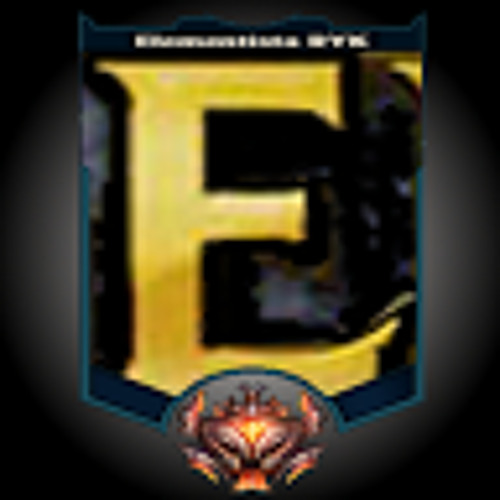

# ⚡ Elementista Flash Vault
Cofre portátil e minimalista para preservação de acervos locais em Flash Player e retroemulação. Desenvolvido em Electron, o Elementista Flash Vault integra emuladores nativos de consoles clássicos (Atari, Mega Drive, SNES) e um player para arquivos swf, com gerenciamento de favoritos, suporte a dois jogadores e interface customizada.

<p align="center">
  
</p>

> **Cofre portátil e minimalista** projetado para a preservação e execução de acervos locais em Flash Player e retroemulação. Desenvolvido em Electron, o ecossistema centraliza players de arquivos `.swf` e emuladores nativos de consoles clássicos em uma interface única, customizada e fluida.

---

## 🕹️ Funcionalidades Principais

* **Player Flash Integrado**
  Execução nativa de arquivos `.swf` locais com alto desempenho.
* **Retroemulação Clássica**
  Suporte embutido para emuladores nativos de consoles lendários como Atari, Mega Drive e Super Nintendo (SNES).
* **Gerenciamento de Favoritos**
  Organize e acesse rapidamente seus jogos e animações prediletas.
* **Suporte a Dois Jogadores**
  Configuração pronta para jogabilidade multiplayer local.
* **Controles Inteligentes**
  Sistema de autodeteção de gamepads conectado via JavaScript.

---

## 📁 Organização do Repositório

| Diretório / Arquivo | Descrição |
| :--- | :--- |
| `binarios/` | Executáveis e emuladores nativos integrados ao ecossistema. |
| `flashver/` | Componentes e dependências para a execução dos arquivos Flash. |
| `build/` | Arquivos e assets de compilação do aplicativo. |
| `index.js` | Script principal do processo Electron (Main Process). |
| `gamepad-autodetect.js` | Gerenciamento e mapeamento dinâmico de joysticks. |

---

## 🚀 Como Executar o Projeto Localmente

### Pré-requisitos
Antes de começar, você precisará do [Node.js](https://nodejs.org) instalado em sua máquina.

### Passo a Passo no Terminal

1. **Clone o repositório**
   ```bash
   git clone https://github.com/elementista/elementista-flash-vault
   ```

2. **Acesse a pasta**
   ```bash
   cd elementista-flash-vault
   ```

3. **Instale as dependências**
   ```bash
   npm install
   ```

4. **Inicie o aplicativo**
   ```bash
   npm start
   ```
---

## 📦 Empacotamento e Distribuição

Para gerar os executáveis finais do projeto, utilize os comandos abaixo no terminal:

• **Empacotar para o sistema Linux:**
```bash
npm run dist
```

• **Empacotar para o sistema Windows:**
```bash
npm run dist:win
```


---

## 📄 Licença

Este projeto é distribuído sob a licença **MIT**. Consulte o arquivo [LICENSE](LICENSE) para obter mais detalhes.

---
<p align="center">
  Desenvolvido por <a href="https://github.com">elementista</a> 👾
</p>
